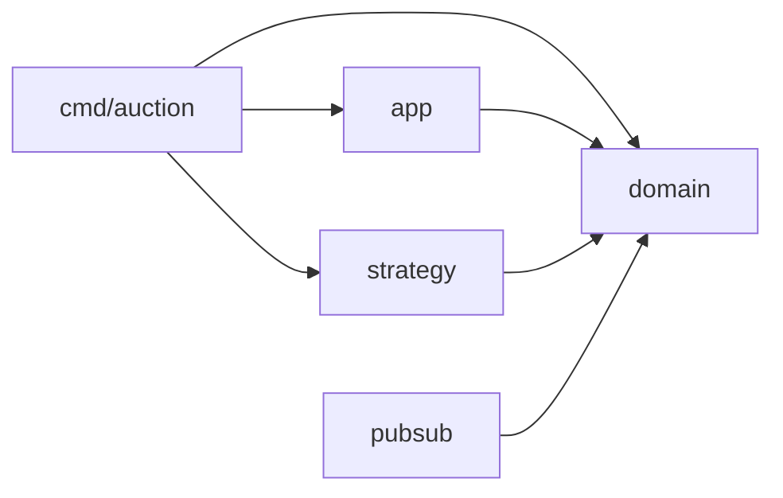

# subastas-go

Subasta concurrente en Go con tres estrategias de sincronización intercambiables
(Mutex, CAS con `atomic` y actor por canal), cierre por plazo con `context`,
auditor de invariantes y Pub/Sub con cola acotada por suscriptor.
Proyecto integrador de Programación Concurrente: **Aplicación concurrente Go**.

Autor: Jared Torres Morga (233310).

## Requisitos
- Go 1.27.3 (la versión que declara `go.mod`; con Go 1.21 o superior el toolchain correcto se descarga solo)
- Sin dependencias externas salvo `go.uber.org/goleak` (solo para pruebas)

## Ejecutar (menos de 5 minutos)

```bash
git clone https://github.com/Jaredtorr/subastas-go.git
cd subastas-go
go run ./cmd/auction -strategy=cas -bidders=32 -timeout=2s
```

Salida esperada: `auditoría: sin violaciones` y el ganador de la subasta.
Con **Ctrl+C** la subasta cierra al instante e imprime el ganador parcial.

| Flag | Descripción | Por defecto |
|---|---|---|
| `-strategy` | `mutex`, `cas` o `actor` | `cas` |
| `-bidders` | número de postores (goroutines) | `16` |
| `-timeout` | duración de la subasta | `2s` |
| `-start` | precio base | `0` |

## Pruebas

```bash
gofmt -l .                       # no debe imprimir nada
go vet ./...
go test -race -count=3 ./...     # carreras, invariantes, cancelación y fugas (goleak)
go test -cover ./...             # cobertura de la lógica central
```

Cobertura medida con `go test -cover ./...`: `app` 97.1 %, `pubsub` 97.4 %,
`strategy` 94.1 % (`cmd` y `domain` sin pruebas propias).

## Benchmarks

Hay dos cargas, ambas con 1, 4, 16 y 64 postores y las tres estrategias:

- `BenchmarkBid` (carga **mixta**): cada postor puja por su cuenta, sin coordinarse.
  Con varios postores la mayoría de las pujas se rechazan, así que mide sobre todo
  el camino de rechazo.
- `BenchmarkBidRising` (carga **creciente**): los montos salen de un contador
  compartido, así que casi todas las pujas se aceptan y se mide el camino de
  aceptación bajo contención.

Ambas reportan `aceptadas/op` (fracción de pujas aceptadas). `ns/op` es tiempo de
pared dividido entre pujas totales: es el inverso del rendimiento, no la latencia
de una puja.

Corrida completa (unos 6 minutos; conviene conectar la laptop a corriente y
cerrar otras aplicaciones):

```bash
mkdir -p results
go test ./internal/app -run='^$' -bench=. -benchmem -count=10 | tee results/bench.txt
go install golang.org/x/perf/cmd/benchstat@latest
~/go/bin/benchstat -col /strategy results/bench.txt | tee results/benchstat.txt
```

Versión rápida para comprobar que funciona (segundos):

```bash
go test ./internal/app -run='^$' -bench=. -benchtime=100x
```

### Resultados

Equipo: MacBook Pro Apple M5 (10 núcleos), macOS, Go 1.27.3. 10 repeticiones
por configuración; la variabilidad entre repeticiones es de ±0 % a ±6 %
(intervalos en `results/benchstat.txt`). Mediana de `sec/op`, menos es mejor:

| Carga | Postores | Mutex | CAS | Actor |
|---|---|---|---|---|
| Mixta | 1 | 4.7 ns | 9.9 ns | 313 ns |
| Mixta | 4 | 97.8 ns | 16.3 ns | 643 ns |
| Mixta | 16 | 66.5 ns | 18.1 ns | 1.05 µs |
| Mixta | 64 | 65.6 ns | 4.5 ns | 1.08 µs |
| Creciente | 1 | 5.3 ns | 10.5 ns | 312 ns |
| Creciente | 4 | 152.9 ns | 66.9 ns | 643 ns |
| Creciente | 16 | 68.6 ns | 90.5 ns | 1.07 µs |
| Creciente | 64 | 61.3 ns | 90.5 ns | 1.11 µs |

Lectura:

- **No hay una estrategia ganadora**: depende de qué fracción de pujas se acepta.
- **CAS gana cuando casi todo se rechaza**: rechazar es una lectura atómica sin
  escritura, y en paralelo no se estorban. Mutex toma el candado también para
  rechazar.
- **Mutex gana cuando casi todo se acepta y hay mucha contención** (16 y 64
  postores): CAS asigna un estado nuevo (1 alloc) y reintenta en cada intento,
  y mutex no asigna nada.
- **Mutex se satura**: con 16 y 64 postores cuesta lo mismo, porque el candado ya
  está ocupado todo el tiempo.
- **Actor es el más lento siempre**, incluso con 1 postor (sin contención): el
  costo es el viaje de ida y vuelta por canal (2 allocs, 160 B por puja). Se
  satura en torno a 1.1 µs, lo que procesa su goroutine dueña. Su ventaja es de
  diseño (estado con un único dueño, sin memoria compartida), no de velocidad.

### Perfiles pprof

```bash
go test ./internal/app -run='^$' -bench='BenchmarkBid/strategy=mutex/bidders=64$' -cpuprofile=cpu.prof -mutexprofile=mutex.prof
go tool pprof -top -nodecount=15 mutex.prof
go tool pprof -top -nodecount=15 cpu.prof
```

Interpretación de los perfiles guardados (mutex con 64 postores y CAS):

- **Mutex**: cerca del 98 % de la espera está en `MutexAuction.Bid` y solo
  alrededor del 1 % del CPU es lógica de la puja; el resto es dormir y despertar
  goroutines. El cuello de botella es la serialización (ley de Amdahl).
- **CAS**: no hay espera por candado y el uso de CPU sube (691 % frente a 418 %),
  pero cerca del 31 % se gasta en reintentos de CAS, más asignación (`&state{}` en
  cada intento) y GC. El cuello pasa a la disputa de la línea de caché.

### Archivos en `results/`

| Archivo | Contenido |
|---|---|
| `bench.txt` | salida cruda de los benchmarks (10 repeticiones) |
| `benchstat.txt` | resumen con intervalos de confianza, por estrategia |
| `pprof-mutex.txt` | perfil de mutex (estrategia mutex, 64 postores) |
| `pprof-cpu.txt` | perfil de CPU (estrategia mutex, 64 postores) |
| `pprof-cpu-cas.txt` | perfil de CPU (estrategia CAS) |

Nota: los perfiles se guardaron antes de renombrar los sub-benchmarks a
`strategy=.../bidders=...`; los comandos de arriba ya usan los nombres nuevos.

## Arquitectura



| Paquete | Contenido |
|---|---|
| `internal/domain` | interfaz `Auction`, `Result` y errores (no importa nada del proyecto) |
| `internal/strategy` | `MutexAuction` (A), `CASAuction` (B), `ActorAuction` (C) |
| `internal/pubsub` | `Broker`, `Subscription`, `Event` y el decorador `Notifying` |
| `internal/app` | `Run` (cierre por plazo), `Bidder` (postores) y `Audit` (auditor) |
| `cmd/auction` | flags, señales y arranque |

### Orden de apagado

1. `Run` cierra la subasta al vencer el plazo, o antes si Ctrl+C / SIGTERM
   cancelan `ctx`.
2. Los postores reciben `ErrClosed` (o ven `ctx.Done()`) y terminan; `main`
   espera con un `WaitGroup`.
3. `main` cancela el contexto del auditor, que hace una última comprobación y
   entrega su resultado.
4. `main` lee el resultado del auditor y comprueba que `Highest()` coincide con
   el resultado del cierre.

### Goroutines

| Goroutine | Quién la lanza | Termina cuando |
|---|---|---|
| `Bidder` ×N | `main` (`go func`; `main` las espera con `WaitGroup`) | `ctx.Done()` o `ErrClosed` al cerrar la subasta |
| `Run` | la propia función `Run`, llamada desde `main` | vence el plazo o se cancela `ctx`; cierra la subasta antes de salir |
| `Audit` | la propia función `Audit`, llamada desde `main` | `main` cancela su contexto (`stopAudit`) tras `wg.Wait()`, o detecta la primera violación |
| Actor | `NewActor` (solo con `-strategy=actor`) | recibe `opClose` |
| Broker (`loop`) | `NewBroker` (solo en pruebas: `main` aún no lo arranca) | se cierra `quit` (`Close`) |

### Canales

| Canal | Capacidad | Escribe | Lee | Cierra |
|---|---|---|---|---|
| resultado de `Run` | 1 | goroutine de `Run` | `main` | goroutine de `Run` |
| resultado de `Audit` | 1 | goroutine de `Audit` | `main` | goroutine de `Audit` |
| `reqs` (actor) | 0 | postores | actor | nadie |
| `done` (actor) | 0 | nadie (solo se cierra) | postores, en el `select` de `call` | actor |
| `reply` (actor, uno por petición) | 1 | actor | el postor que hizo la petición | nadie |
| `pub` (broker) | 256 | `Publish` (vía `Notifying`) | `loop` | nadie |
| `sub` (broker) | 0 | `Subscribe` | `loop` | nadie |
| `quit` (broker) | 0 | nadie (solo se cierra) | `loop` | `Close` (con `sync.Once`) |
| `done` (broker) | 0 | nadie (solo se cierra) | `Subscribe`, `Publish`, `Close` | `loop` |
| cola de suscriptor | `buf` (configurable) | `loop` | el suscriptor | `loop` (excepción: `Subscribe` la cierra si el broker ya terminó, porque `loop` nunca la conoció) |

Los canales `reqs`, `pub` y `sub` nunca se cierran: tienen varios emisores y
cerrarlos provocaría un `panic`. La señal de fin viaja por `done` o `quit`.

## Limitaciones

- Los benchmarks miden el costo de procesar una puja (aceptada o rechazada) bajo
  contención. La carga mixta es la comparación más limpia entre estrategias; en la
  creciente la tasa de aceptación difiere entre estrategias (por ejemplo, con 16 y
  64 postores CAS acepta cerca del 38 % y mutex cerca del 97 %).
- El contador compartido de `BenchmarkBidRising` también está contendido y suma un
  costo que no se midió por separado.
- Mutex con 4 postores es más lento que con 16 y 64 (98 y 153 ns frente a ~66 ns);
  no se verificó la causa.
- `Notifying` publica después de `Bid`, no de forma atómica con él: dos eventos de
  pujas simultáneas pueden llegar en distinto orden, así que los suscriptores deben
  quedarse con el monto máximo, no con el último.
- Actor y Broker solo terminan con `Close()`; en el programa, `Run` siempre cierra
  la subasta.
- La prueba de `Notifying` usa un `testAuction` local para que `pubsub` no dependa
  de `strategy`.
- El Pub/Sub está implementado y probado, pero aún no está conectado a la línea de
  comandos.