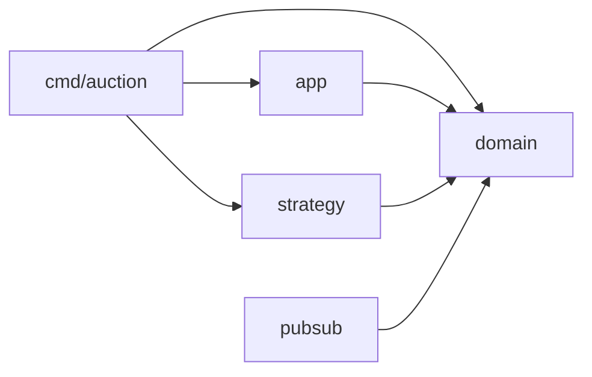

# subastas-go

Subasta concurrente en Go con tres estrategias de sincronización intercambiables
(Mutex, CAS con `atomic` y actor por canal), cierre por plazo con `context`,
auditor de invariantes y Pub/Sub con cola acotada por suscriptor.
Proyecto integrador de Programación Concurrente.

## Requisitos

- Go 1.22 o superior (`go version`)
- Sin dependencias externas salvo `go.uber.org/goleak` (solo para pruebas)

## Ejecutar (menos de 5 minutos)

```bash
git clone https://github.com/Jaredtorr/subastas-go.git
cd subastas-go
go run ./cmd/auction -strategy=cas -bidders=32 -timeout=2s
```

Salida esperada: `auditoría: sin violaciones` y el ganador de la subasta.
Con **Ctrl+C** la subasta cierra al instante e imprime el ganador parcial.

| Flag | Descripción | Por defecto |
|---|---|---|
| `-strategy` | `mutex`, `cas` o `actor` | `cas` |
| `-bidders` | número de postores (goroutines) | `16` |
| `-timeout` | duración de la subasta | `2s` |
| `-start` | precio base | `0` |

## Pruebas

```bash
gofmt -l .                       # no debe imprimir nada
go vet ./...
go test -race -count=3 ./...     # carreras, invariantes, cancelación y fugas (goleak)
go test -cover ./...             # cobertura de la lógica central
```

## Benchmarks y perfiles

```bash
mkdir -p results
go test ./internal/app -run='^$' -bench=BenchmarkBid -benchmem -count=5 | tee results/bench.txt
go test ./internal/app -run='^$' -bench='BenchmarkBid/mutex/bidders=64' -cpuprofile=cpu.prof -mutexprofile=mutex.prof
go tool pprof -top -nodecount=15 mutex.prof
go tool pprof -top -nodecount=15 cpu.prof
```

Los resultados guardados están en `results/`.

## Arquitectura



| Paquete | Contenido |
|---|---|
| `internal/domain` | interfaz `Auction`, `Result` y errores (no importa nada del proyecto) |
| `internal/strategy` | `MutexAuction` (A), `CASAuction` (B), `ActorAuction` (C) |
| `internal/pubsub` | `Broker`, `Subscription`, `Event` y el decorador `Notifying` |
| `internal/app` | `Run` (cierre por plazo), `Bidder` (postores) y `Audit` (auditor) |
| `cmd/auction` | flags, señales y arranque |

### Goroutines

| Goroutine | La crea | Termina cuando |
|---|---|---|
| `Run` | `main` | vence el plazo o se cancela `ctx` |
| `Bidder` ×N | `main` | `ctx.Done()` o `ErrClosed` |
| `Audit` | `main` | se cancela su contexto o detecta una violación |
| Actor | `NewActor` | recibe `opClose` |
| Broker (`loop`) | `NewBroker` | se cierra `quit` |

### Canales

| Canal | Capacidad | Escribe | Lee | Cierra |
|---|---|---|---|---|
| resultado de `Run` | 1 | goroutine de `Run` | `main` | goroutine de `Run` |
| resultado de `Audit` | 1 | goroutine de `Audit` | `main` | goroutine de `Audit` |
| `reqs` (actor) | 0 | postores | actor | nadie |
| `pub` (broker) | 256 | `Notifying` | `loop` | nadie |
| cola de suscriptor | configurable | `loop` | el suscriptor | `loop` |

## Estado

- El Pub/Sub está implementado y probado (`internal/pubsub`); aún no está
  conectado a la línea de comandos.